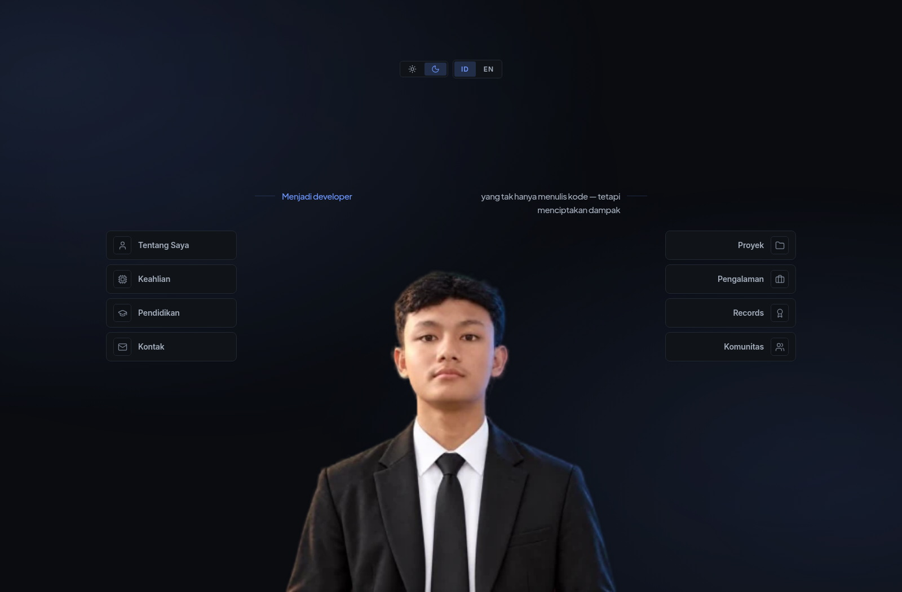
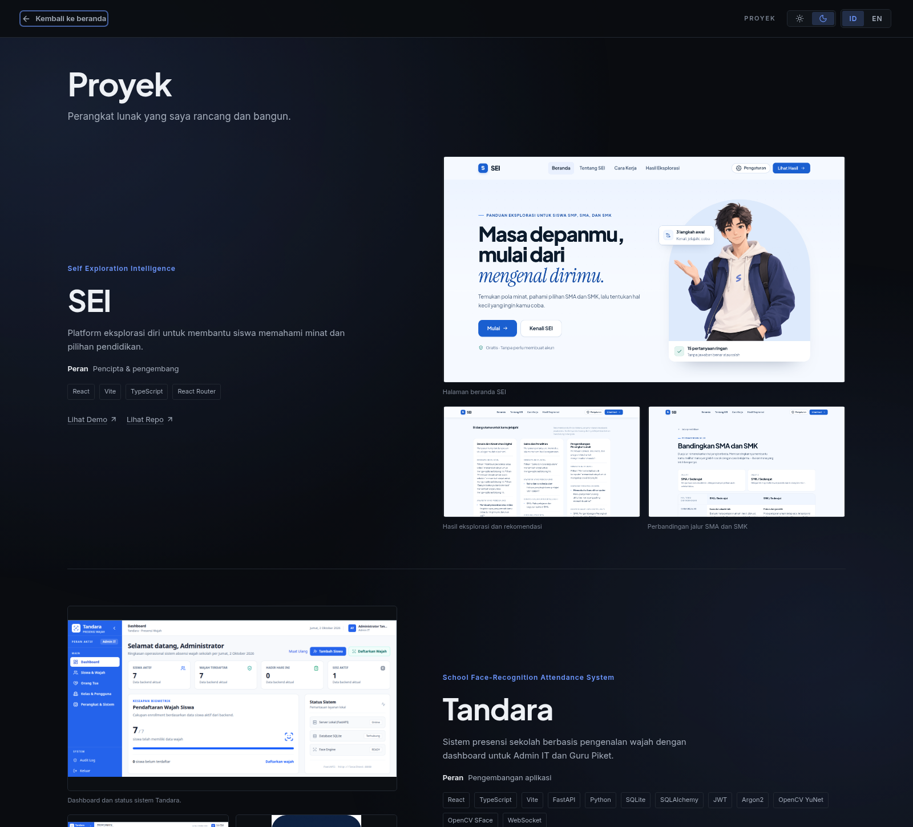
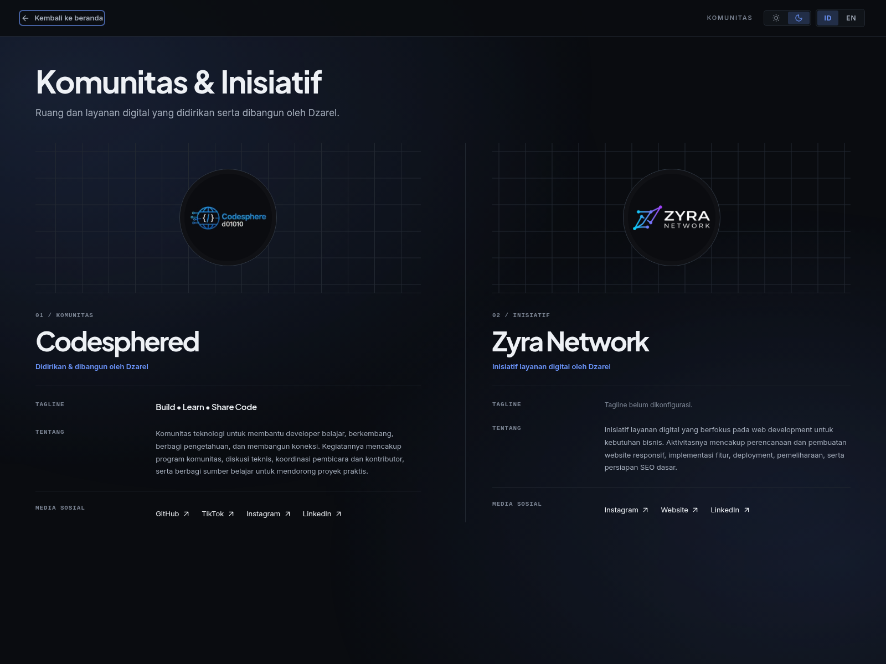
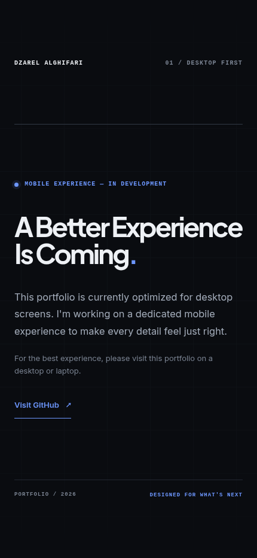

# Dzarel — Portfolio

Portfolio personal Muhamad Dzarel Alghifari (DzarelDeveloper), dibuat dengan React, TypeScript, dan Vite. Situs menampilkan profil, keahlian, proyek pilihan, pengalaman, pendidikan, pengakuan, komunitas, dan kontak.

## Tampilan

| Homepage | Projects |
| --- | --- |
|  |  |

| Communities & Initiatives | Mobile Coming Soon |
| --- | --- |
|  |  |

## Fitur

- Navigasi section dengan dukungan browser back/forward.
- Tema terang/gelap dan bahasa Indonesia/Inggris.
- Showcase proyek, pengalaman, pendidikan, pengakuan, komunitas, dan kontak.
- Layar Mobile Coming Soon untuk viewport di bawah 768 px; pengalaman portfolio utama difokuskan untuk desktop.
- Metadata SEO, Open Graph, sitemap, robots.txt, dan structured data Schema.org.

## Teknologi

- React 19
- TypeScript
- Vite
- Lucide React
- CSS Modules

## Menjalankan secara lokal

Persyaratan: Node.js dan npm.

```bash
npm ci
npm run dev
```

Perintah pemeriksaan dan production:

```bash
npm run typecheck
npm run build
npm run preview
```

Build production dibuat di direktori `dist/`.

## Struktur konten

- `src/data/` — konten profil, proyek, pengalaman, pendidikan, komunitas, dan pengakuan.
- `src/components/` — komponen layout, navigasi, dan section.
- `src/i18n/` — teks antarmuka Indonesia dan Inggris.
- `public/assets/` — gambar, logo, dan aset statis.
- `docs/screenshots/` — screenshot untuk dokumentasi ini.

## Kontak

- Email: [dzarelalghifari123@gmail.com](mailto:dzarelalghifari123@gmail.com)
- GitHub: [DzarelDeveloper](https://github.com/DzarelDeveloper)
- LinkedIn: [dzareldeveloper](https://www.linkedin.com/in/dzareldeveloper/)
- Instagram: [buildwithdzarel](https://www.instagram.com/buildwithdzarel/)
